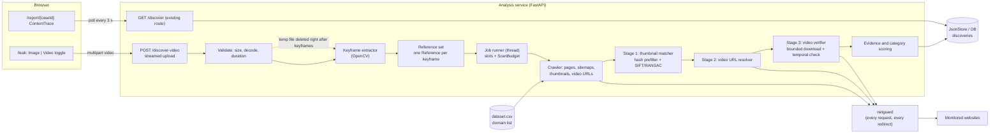
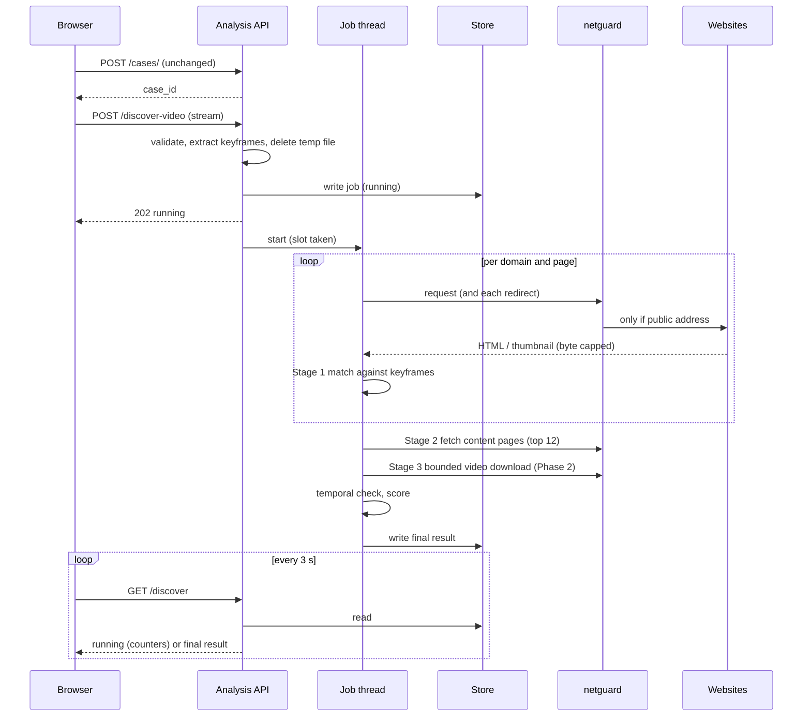
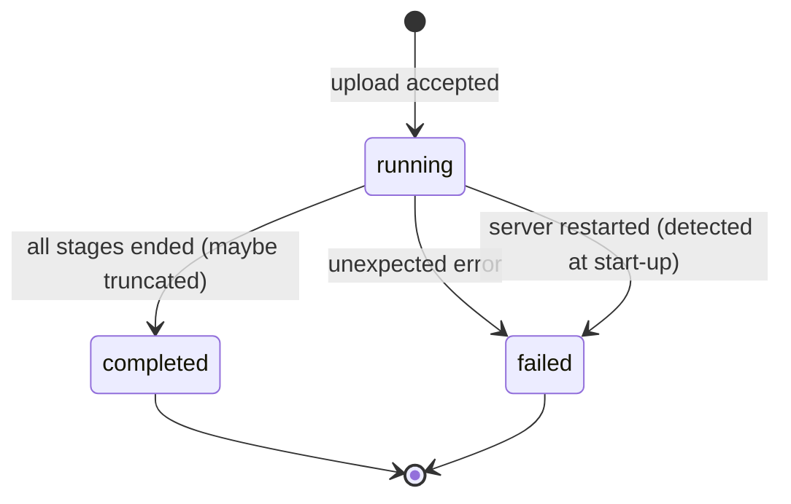

# Image feature: fixes and improvements, and the video feature architecture

This document has two parts.

- **Part 1** lists what was wrong with the image feature, what was changed, why, and what evidence shows it works. Everything in Part 1 is implemented and tested.
- **Part 2** is the workflow and architecture of the video feature **as it should be built on top of the fixed image feature**. Nothing in Part 2 is implemented yet. It is a design.

The video feature itself was not touched.

---

# Part 1: Image feature

## 1. Summary

The image feature already worked in outline: upload an image, crawl a list of sites, hash-compare thumbnails, show matches. Review of the code found three kinds of trouble:

1. **It showed things that were not true.** Fake sample matches, a demo flag that leaked into real scans, wrong site counts, a hard-coded SSIM of 0.
2. **It could not tell "no match" from "could not check".** Blocked, unreachable and JavaScript-only sites were silently skipped.
3. **It missed real copies and was unsafe at scale.** Cropped or mirrored copies were missed, scans were unbounded, state was lost on restart, and the crawler would fetch internal addresses.

### Measured result

Test: 9 sample photographs, each turned into 9 kinds of copy (81 copies), plus 198 unrelated images and 24 "hard negatives" (a different region of the same image). Run it yourself: `python services/analysis/tests/calibration.py`.

| Transformed copy | Old rule | New rule |
|---|---|---|
| thumbnail 320 px | 9 / 9 | 9 / 9 |
| thumbnail 160 px | 9 / 9 | 9 / 9 |
| JPEG quality 30 | 9 / 9 | 9 / 9 |
| **mirrored** | **0 / 9** | **9 / 9** |
| crop, centre 75% | 7 / 9 | 9 / 9 |
| **crop, corner 60%** | **3 / 9** | **9 / 9** |
| watermark | 8 / 9 | 9 / 9 |
| letterbox bars | 8 / 9 | 9 / 9 |
| brightness and contrast | 9 / 9 | 9 / 9 |
| **Recall** | **62 / 81 = 77%** | **81 / 81 = 100%** |
| False alarms, 198 unrelated images | 0 | 0 |
| False alarms, different region of same image | **2 / 24** (brick texture) | **0 / 24** |

Read this honestly: it is a small, synthetic test set built from 9 photos. It shows the new rule is better on the cases it covers and does not show a real-world accuracy figure. Section 7 describes how to calibrate on real data.

Cost: matching an unrelated 320 px thumbnail takes about 57 ms; a hash-exact copy about 7 ms; a cropped copy about 80 ms (measured on the test machine). Building the reference once per scan takes about 250 ms. This is why work runs in a thread pool and is capped by a budget (section 3.3).

---

## 2. Problem by problem

Numbers match the review list.

### A. Wrong or misleading output

| # | Problem | Change | Why it helps | Evidence |
|---|---|---|---|---|
| 1 | The match panel filled with hard-coded sample matches after 1.8 s; zero real matches never showed "Clear". | `ContentTrace.tsx`: all mock data deleted. It now polls the real scan and shows five real states: connecting, in progress (live counters), failed (with reason), no matches (with coverage), and matches. "Clear" is gone; it now says "No matches found" and what that does and does not cover. Wording changed from "confirmed hosting" to "visually matches". | A report that may go to police or a lawyer can no longer contain invented evidence. | Type-check clean. **No browser test was run.** |
| 2 | `demo=true` set a global flag that was never reset, so later scans returned scripted data. | `run_discovery_scan(demo=...)` is a per-request argument. The router no longer touches module state. `SNIFFER_DEMO_MODE=1` remains for local demos only. | One demo request can no longer poison every later real scan. | `test_demo_flag_does_not_leak_between_scans` (engine) and `test_demo_flag_is_per_request_and_never_global` (API). |
| 3 | UI said "91 domains" and "under 60 seconds"; 83 are scanned and scans take minutes. | Text no longer states a number. The report shows `reachable / total` taken from the backend. | The user is told what actually happened. | Code review. |
| 4 | Every match showed "SSIM 0.00" (hard-coded). | A real SSIM is computed (both images to 128×128 grey, compared with the matched variant of your image). The UI shows "–" when unavailable. | The number now means something. | `test_finds_copy_via_sitemap...` asserts SSIM above 0.5 on a real copy. |
| 5 | `domains_scanned` counted only domains with a match. | It now counts reachable, parsed domains. A separate `domains_with_matches` was added. | Progress numbers are correct. | `test_domain_status_distinguishes...` asserts 5 reachable, 2 with matches. |
| 6 | Blocked, timed-out or JavaScript-only sites were silently skipped. | Every domain gets a status: `checked`, `no_images`, `blocked`, `unreachable`, or `skipped`. `coverage` holds the counts. The report shows them. | "No match" and "could not check" are now different statements. | Same test. |

### B. Inputs the backend ignored

| # | Problem | Change | Evidence |
|---|---|---|---|
| 7 | The evidence screenshot was sent and ignored. | `/discover` accepts `evidence_image`, stores its SHA-256 and an ELA check in `result.evidence`. A failure here never fails the scan. | `test_full_scan_via_api...` asserts the hash is stored. **The report page does not display it yet.** |
| 8 | The platform was never sent as `origin_domain`, so prioritisation never ran. | New optional field on `/leak`: "Seen on a specific site?". The backend reduces a pasted URL to its hostname, rejects anything that is not a plain hostname (IP addresses, ports, spaces), and scans that site's network first. | Same test; `test_input_validation`. **Limit:** it only has an effect if the site is in the dataset. The platform buttons (Telegram, etc.) are not in it, so they are deliberately not sent. |
| 9 | Live progress events were thrown away by the response model. | The router merges events and counters into the stored record; the UI shows live counters. | `recent_events` asserted non-empty. **Limit:** matches only appear when the scan completes, not as they are found. |

### C. Reliability and safety

| # | Problem | Change | Evidence |
|---|---|---|---|
| 10 | All state was in memory; a restart lost everything. | New `engine/store.py`: atomic JSON files, strict ID validation (no path traversal), retention (`SNIFFER_RETENTION_DAYS`, default 7). Cases and scan results are written through to it. At startup, scans that were running are marked failed with a clear message. | `test_result_and_case_survive_a_restart`, `test_scan_interrupted_by_restart...`, store tests. **Also proven on a real server:** case and result survived a real process restart. |
| 11 | Unlimited threads; up to about 20,000 requests per scan. | At most 2 scans run at once (`429` otherwise); a second scan on the same case gets `409`. Per-scan budget: 8,000 images and 600 seconds. A scan that hits a limit says so (`truncated`, `truncation_reason`) and unfinished sites are marked `skipped`, not "no images". | `test_too_many_concurrent_scans_gets_429`, `test_request_budget_truncates_honestly`. |
| 12 | Page and image URLs were fetched without checks, redirects followed freely. | New `engine/netguard.py`, installed as an httpx hook, so it runs on **every request including every redirect hop**. It allows only http/https on ports 80, 443, 8080, 8443 and requires every resolved IP to be globally routable (blocks private, loopback, link-local, cloud-metadata, CGNAT, IPv4-mapped IPv6). Downloads are streamed and abandoned at the byte cap (previously a huge file was downloaded in full before the size check). | 17 netguard tests including a redirect from a public host to `169.254.169.254`. **Residual risk:** DNS can change between the check and the connection (rebinding); run the crawler with egress filtering for full protection. |
| 13 | Hashing and keypoint work ran inside the async loop. | Matching runs in worker threads (4 at a time) so downloads are not blocked. | Crawler test suite passes. No benchmark was run. |
| 14 | One page appeared several times in the results. | Results are consolidated per content page, keeping the best match; other matching thumbnails go to `alt_image_urls`. Matches that only point at a listing page are keyed by image, so different videos on one listing page are not merged. | `test_duplicate_thumbnails_of_one_page_collapse_into_one_result`. |

---

## 3. Improvements for finding closer matches

### 3.1 Geometric verification (improvement 3)

Before, a match was decided by the share of ORB keypoints that matched. After (`engine/geometry.py`):

1. Both images are normalised: longest side 512 px, CLAHE contrast.
2. SIFT features are extracted and matched with Lowe's ratio test (0.75).
3. The surviving matches must agree on **one** transform (scale, rotation, translation), found with RANSAC. The count of agreeing matches is the **inlier count**.
4. Decision: at least 15 inliers is a *structural* match (confidence 70 to 95); 10 to 14 is *probable*; both also need an inlier ratio of at least 0.30. The transform scale must be between 0.2× and 5×.

I used a similarity transform and not a full perspective homography, because thumbnails are scaled or cropped frames, not photographs of a screen. Fewer free parameters means fewer chance agreements. If SIFT is unavailable the previous ORB rule is used as a fallback (`match_method: "orb_fallback"`).

Why it matters: the old rule falsely matched the brick texture to a different part of itself (2 of 24 hard negatives); the new rule did not (0 of 24).

### 3.2 Matching against variants of your image (improvement 4)

The reference is prepared once: original, mirrored, and centre crops at 16:9, 4:3, 1:1 and 9:16 (skipped if equal to the original's shape). Hashes are compared against all variants; SIFT features are kept for original and mirrored. EXIF rotation is applied to both sides. A hash hit on the original is `exact`; on a variant it is `near_duplicate`, and the report says which ("mirrored copy", "cropped 16:9"). Candidates under 48 px (icons, tracking pixels) are ignored.

### 3.3 Finding more pages (improvement 2)

Before, only the homepage and up to 10 links with words like "video" were scanned. Now, per domain (`_discover_pages`):

- `robots.txt` is read for sitemap URLs, falling back to `/sitemap.xml`. One level of sitemap index is followed.
- Sitemap pages are ranked: keyword pages first, newest first (`lastmod`), skipping pages like privacy or login.
- The RSS feed advertised in the homepage `<link rel="alternate">` is read.
- If `https` fails, `http` is tried.
- The homepage is fetched once and reused (it used to be fetched twice).
- Sitemaps are parsed with a regular expression, not an XML parser, so a hostile file cannot trigger entity-expansion attacks.

Up to 15 pages per domain (`SNIFFER_MAX_PAGES_PER_DOMAIN`), half reserved for sitemap pages.

### 3.4 More image sources (improvement 5)

`_extract_asset_urls` now reads: `og:image`/`twitter:image` variants; lazy-load attributes (`data-src`, `data-original`, `data-lazy-src`, and similar, which are preferred over placeholder `src`); `srcset` (largest candidate); `<picture>`; `<video poster>`; `<link rel=image_src|preload>`; JSON-LD `thumbnailUrl`/`image`; inline CSS `background-image`; direct image links. Up to 32 per page.

### 3.5 Related domains (improvement 7)

75 of 91 dataset rows have no network, so "related domains" was mostly empty. Sites that share the **same video CDN** as a matched site are now listed too (the data already exists in the `video_provider` column). I did not invent network names.

### 3.6 Calibration harness (improvement 8)

`tests/calibration.py` generates the copies and negatives and prints the table in section 1. Thresholds in `engine/discovery.py` (`HASH_MAX_AVG_DISTANCE`, `GEO_STRUCTURAL_INLIERS`, `GEO_PROBABLE_INLIERS`, `GEO_MIN_INLIER_RATIO`) are named constants so they can be re-tuned.

### 3.7 Small defects found while testing

- **`requests` was missing from `requirements.txt`**, although `deepfake_model.py` imports it. In a clean environment the whole analysis service failed to import. Added.
- Decompression-bomb guard (images over 40 megapixels are rejected before decoding).
- Upload read is bounded (never reads more than the limit into memory); unreadable images get `422` instead of failing later.

---

## 4. Not done, and why

| Item | Status | Reason |
|---|---|---|
| Headless browser for JavaScript-only sites | Not done | Heavy and a new attack surface. Such sites are now reported as `no_images` instead of hidden. |
| Search by title/username through each site's own search page | Not done | Needs a per-site search URL pattern, which the dataset does not have. A `search_url_template` column would unlock it. |
| Embedding re-ranker (CLIP, DINOv2) | Deferred | Adds model weight and compute; the geometric matcher already reaches 100% on the test set. Re-evaluate on real data. |
| Pagination and category-page crawling | Not done | Sitemaps and feeds come first; add if coverage measurements show a gap. |
| Network names for the 75 unknown rows | Partly | Needs human-verified data. CDN grouping covers part of it. |
| Rendering `result.evidence` in the report | Not done | Backend stores it; no UI yet. |
| Showing matches live during a scan | Not done | Matches arrive at completion. |

**Seen but outside this task, left untouched:** the takedown service fetches `https://{domain}` for any domain with certificate checks off (same SSRF class as item 12, but a different service); the `/run` scoring weights and the dashboard key mismatch described in the first review; the in-memory registry and `/run` results.

---

## 5. API changes (all backward compatible)

`POST /api/analysis/{case_id}/discover`

| | Before | After |
|---|---|---|
| Form fields | `suspicious_image`, `origin_domain`, `demo` | adds optional `evidence_image` |
| `origin_domain` | any string | validated hostname; `422` otherwise |
| New status codes | | `409` scan already running for this case; `422` unreadable image; `429` too many scans |

`GET /api/analysis/{case_id}/discover`: same route. If the process restarted mid-scan the record comes back as `failed` with an explanation, not stuck on `running`.

New fields on the result: `domains_with_matches`, `domain_status`, `coverage`, `truncated`, `truncation_reason`, `evidence`. New fields on each match: `match_method`, `matched_variant`, `alt_image_urls`, `page_specific`. The old fields are unchanged; `match_type` gains `structural`/`near_duplicate` values the UI already knew how to label.

## 6. Configuration

| Variable | Default | Meaning |
|---|---|---|
| `SNIFFER_DATA_DIR` | `services/analysis/.data` | Where cases and scans are stored. Git-ignored. Contains sensitive data: protect it. |
| `SNIFFER_RETENTION_DAYS` | 7 | Records older than this are deleted at startup. |
| `SNIFFER_MAX_CONCURRENT_SCANS` | 2 | Parallel scans. |
| `SNIFFER_MAX_PAGES_PER_DOMAIN` | 15 | Pages scanned per site. |
| `SNIFFER_MAX_ASSETS_PER_PAGE` | 32 | Images compared per page. |
| `SNIFFER_MAX_TOTAL_CANDIDATES` | 8000 | Image budget per scan. |
| `SNIFFER_SCAN_TIMEOUT_SECONDS` | 600 | Time budget per scan. |
| `SNIFFER_NETGUARD` | 1 | Set to 0 only for local testing against private hosts. |
| `SNIFFER_DEMO_MODE` | 0 | Forces demo results process-wide (local demos only). |

## 7. How it was verified

| Check | Result |
|---|---|
| `pytest services/analysis/tests` | **34 passed** (crawler against fake in-process sites, API, network guard, store) |
| `python tests/calibration.py` | Table in section 1 |
| Real `uvicorn` server: create case, run scan, stop, restart | Case and scan result still returned; both stored as files |
| `tsc --noEmit` on the web app | 0 errors |
| ESLint on the three changed web files | 0 errors; 1 warning that already existed (`MATCH_CLASSES` unused) |

**Not verified:** a crawl of the real internet (no external requests were made, by design); the Next.js build and full lint; the UI in a browser; MongoDB paths. The crawler tests use fake sites, so behaviour on real sites (blocking, JavaScript, layouts) still has to be observed.

**Recommended next step to trust the numbers:** assemble a labelled set of real copies and unrelated items (with consent and privacy review), run the calibration against it, and adjust the named thresholds.

**Run the tests**

```bash
cd services/analysis
pip install -r requirements.txt -r requirements-dev.txt
python -m pytest tests -q
python tests/calibration.py
```

---

# Part 2: Video feature, workflow and architecture (design only)

> **Update:** this design has since been built. See `VIDEO_FEATURE.md` for what was actually implemented, how it was verified, and where the build differs from this design (one video scan at a time; a separate `engine/matching.py`; verification statuses `verified`, `partial`, `no_frame_match`, `not_verified`, `not_attempted`; thumbnails on listing pages are not searched for a video URL). The text below is the original design.
>
> It describes how the video feature should be built **on top of the fixed image feature**, so that the same safeguards, the same honest reporting and the same matcher apply.

## 8. Goal and principles

A user uploads a video. The system returns, for each website where a copy may exist: **site name, source page URL, direct video URL (when it can be found), and a match confidence with the evidence behind it.**

Principles:

1. **Three separate questions.** *Discovery*: which pages might have it? *Identification*: where is the actual video file? *Verification*: is it really a copy?
2. **Reuse, do not fork.** The crawl, the guard, the budgets, the storage and the report are the ones fixed in Part 1.
3. **Evidence, not a bare percentage.** The report shows categories and the reasons for them.
4. **Say what was not checked.** A failed or skipped step is reported as such, never as "no match".
5. **The image feature keeps working unchanged.**

## 9. What the image fixes give the video feature

| Fixed in Part 1 | Used by video for |
|---|---|
| `netguard` on every request hop | Fetching content pages, and downloading candidate videos, safely |
| `ScanBudget` and scan slots | Limiting a video job's work and keeping heavy jobs to a small number |
| `JsonStore` and restart recovery | Job state that survives restarts (a Mongo-backed store can replace it later) |
| `domain_status` and `coverage` | Telling "not found" from "could not check" |
| Sitemaps, feeds, JSON-LD, `srcset` | Finding video pages and their poster images |
| Geometric matcher and reference variants | Comparing each keyframe with candidate thumbnails and, later, with frames of the candidate video |
| Consolidation by page | One result per video page |
| Real-data-only `ContentTrace` | The same report states, with new fields |
| Per-request flags | No shared state between users' jobs |

## 10. Architecture



## 11. End-to-end workflow

| # | Step | Component | What happens | Output |
|---|---|---|---|---|
| 0 | Choose video | `/leak` | Toggle to Video; client checks type `video/*` and size (max 100 MB). A poster frame is drawn to a canvas and saved to `sessionStorage` for the report preview. | File + preview |
| 1 | Create case | `POST /api/cases/` (unchanged) | Same as images. | `case_id` |
| 2 | Upload | `POST /api/analysis/{id}/discover-video` | The upload is **streamed to a temp file** with a byte cap (never held in memory). The MIME type is not trusted: the file must decode with OpenCV, have at least one frame, and stay under the duration cap (10 min). Errors: `413`, `415`, `422`, `429`, `409`. | Validated temp file |
| 3 | Keyframes | `engine/video.py` | Sample timestamps spread evenly across the video (6 to 16 frames, about one per 2 s), plus extra frames at scene changes. Drop near-black frames and near-duplicates (pHash distance ≤ 2). Downscale to 640 px. Keep each frame's timestamp. | `[(t, image)]` |
| 4 | Reference set | `build_reference` per frame | Each keyframe becomes a `Reference` (hash variants, SIFT features). About 0.25 s per frame, so a few seconds in total. The **temp video is deleted now.** | `VideoReference` |
| 5 | Job | Router | Job record `input_type: "video"`, `reference_frames: N`; takes a scan slot (video jobs have their own lower cap); stored through `JsonStore`; thread started. Returns `202`. | `running` record |
| 6 | Crawl | Existing `_discover_pages`, `_scan_page` | Unchanged: homepage links, sitemaps, feeds, guarded fetches, byte caps, budgets. In the same pass each page's video URLs are collected (see 11.1). | Pages, thumbnails, video URL hints |
| 7 | **Stage 1: thumbnail match** | `match_candidate_video` | For each thumbnail: hash it once, compare with all keyframes (cheap prefilter, keeps the best frame), then run SIFT/RANSAC against the 3 closest keyframes only. Record the best keyframe index and its timestamp. | Candidate with `matched_frame_time` |
| 8 | Consolidate | `_consolidate_matches` | One result per video page. Pages with several matching images count distinct keyframes matched (`frames_matched`). | Top 12 |
| 9 | **Stage 2: find the video URL** | Resolver | For each of the top 12, fetch the content page (guarded) and read: `og:video` and variants, `<video src>` and `<source>`, JSON-LD `contentUrl`, `.mp4/.webm/.m3u8` links in the page source. Classify as `direct` (file), `stream` (`.m3u8`, a playlist, never treated as a file), or `embed`. If nothing is found: `video_url: null`, source page kept. | `video_url`, `video_url_type` |
| 10 | **Stage 3: verify** (Phase 2) | `engine/verify.py` | Only for `direct` URLs that pass the guard: download at most 6 MB (streamed, `Range` header, abandoned at the cap), decode up to 8 frames, compare them with the keyframes, and check **temporal order** (11.2). Failure to decode is `not_verified`, not "failed". | `verification` block |
| 11 | Score | Scoring | Combine evidence into a category (section 12). | `category`, `confidence`, `evidence` |
| 12 | Persist | `JsonStore` | Final record written; temp files already gone; retention applies. | Stored job |
| 13 | Report | `ContentTrace` | Same polling as images. Shows category, evidence, matched time, source page, video URL (when found) and coverage. | UI |
| 14 | Act | `LeakActionConsole` | The takedown notice includes the video URL and matched time. Nothing is sent automatically. | Draft notice |

### 11.1 Collecting video URLs

Listing pages usually link to a video page and do not contain the file, so the video URL comes from the *content page* (step 9), after a thumbnail has already matched. This avoids downloading anything just to find an address. Sites that build the player URL in JavaScript will yield `null`; that is reported, not guessed.

### 11.2 Temporal check (the key difference from images)

A single similar thumbnail can match by coincidence. Several distinctive frames matching **in the same order** is much stronger. In Stage 3, for each decoded frame of the candidate (time `c`), find the keyframe it matches (time `k`). Take the matched pairs `(c, k)`, ordered by `c`. The longest run in which `k` also increases is the **ordered match count**. The segment from the first to the last ordered match gives `matched_segment` (for example 00:14 to 00:27 of your video).

Starting rule (to be calibrated): at least 3 ordered frame matches, each passing the geometric test. Limits to state plainly: it needs your clip to overlap the **first part** of their video (only about 6 MB is read); MP4 files whose index is at the end cannot be decoded from a partial download; HLS streams are not downloaded in Phase 2.

## 12. Evidence and categories

The numeric `confidence` is kept for compatibility, but the report leads with the category and its reasons. Every box below is a separate fact:

| Evidence | Meaning |
|---|---|
| `thumbnail_match` | A page image resembles one of your frames |
| `frames_matched` | How many distinct keyframes matched across the page's images |
| `video_url_found` | A video address exists (this alone proves nothing) |
| `ordered_frames` | Frames of their real video matched yours in order |
| `matched_segment` | Where in your video the match lies |
| `verification` | `verified`, `not_verified` (and why), or `not_attempted` |

| Category | Rule (starting point, calibrate before relying on it) |
|---|---|
| **Possible match** | One probable-tier thumbnail match |
| **Strong match** | Exact or structural thumbnail match, or two or more keyframes matched on one page |
| **Video verified** | Stage 3 finds at least 3 geometrically verified frames in matching order |

The report states that this is visual-similarity evidence and does not establish ownership or illegality.

## 13. Sequence



## 14. Job states



`completed` with `truncated: true` means a time or request budget stopped the scan early, and unfinished sites are marked `skipped`.

## 15. API contract

**Request**

```
POST /api/analysis/{case_id}/discover-video     multipart/form-data
  video            file     required   mp4, mov, webm, mkv   (max 100 MB, max 10 min)
  origin_domain    string   optional   same validation as images
  evidence_image   file     optional   same as images
```

Responses: `202` queued; `409` already running; `413` too large; `415` wrong type; `422` cannot be decoded or too long; `429` too many scans.

**Result** (same `GET /discover`; new fields are optional, so image results are unchanged)

```json
{
  "status": "completed",
  "input_type": "video",
  "reference_frames": 12,
  "coverage": {"checked": 51, "no_images": 9, "blocked": 11, "unreachable": 8, "skipped": 0},
  "truncated": false,
  "direct_matches": [
    {
      "domain": "example.com",
      "page_url": "https://example.com/watch/123",
      "video_url": "https://cdn.example.com/v/123.mp4",
      "video_url_type": "direct",
      "image_url": "https://example.com/t/123.jpg",
      "category": "strong",
      "confidence": 82.0,
      "match_type": "structural",
      "matched_frame_time": 18.0,
      "evidence": {
        "thumbnail_match": true,
        "frames_matched": 2,
        "video_url_found": true,
        "ordered_frames": null,
        "matched_segment": null,
        "verification": "not_attempted"
      }
    }
  ]
}
```

## 16. Data model additions

| Record | Field | Type | Notes |
|---|---|---|---|
| Job | `input_type` | `"image"` or `"video"` | Defaults to `image` |
| Job | `reference_frames` | int | Number of keyframes kept |
| Match | `video_url`, `video_url_type` | string, `direct`/`stream`/`embed`/null | `null` when not found |
| Match | `category` | `possible`/`strong`/`verified` | Headline for the UI |
| Match | `matched_frame_time` | float seconds | Best keyframe's time in the user's video |
| Match | `evidence` | object | Section 12 |
| Match | `matched_segment` | `{start, end}` seconds or null | Phase 2 |

The uploaded video and its frames are **not** stored after keyframe extraction. Only the evidence needed for the report is kept, under the same retention period as images.

## 17. Failure behaviour

| Situation | Result |
|---|---|
| Not a video, corrupt, or too long | `422` with a plain message; temp file deleted |
| Page blocked or unreachable | Counted in `coverage`, never "clear" |
| No video URL on a matched page | `video_url: null`, page still reported |
| Verification impossible (index at end, HLS, blocked address) | `verification: not_verified` with the reason |
| Time or request budget hit | `truncated: true`; unfinished sites `skipped` |
| Server restarts mid-scan | Record becomes `failed` with a restart message |
| Worker error | `failed` with a generic message; details only in the server log |
| Client closes the page | The scan continues; the result is there when they return (until retention ends) |

## 18. Security and privacy

- The user's video is an intimate, sensitive file: stream it to disk with a cap, delete it as soon as keyframes exist, never log its content, keep nothing but report evidence.
- Every outbound request goes through `netguard` (public addresses only, redirects re-checked, port allow-list). The new video download adds a **per-candidate byte cap, a time limit and a limit on candidates verified per job**.
- Decoding untrusted files is a risk. Run the decode step with a time limit and keep OpenCV updated; consider a separate low-privilege worker process later.
- Video jobs have a lower concurrency cap than image jobs.
- No face recognition, and no sending of frames to third-party search services, unless the user gives explicit consent after a privacy review. Search-based discovery beyond the monitored list is a separate decision.
- Access control is still missing in the wider application (anyone with a case ID can read it). It matters more for video; fix it before launch.

## 19. Files that would change

| File | Change |
|---|---|
| `services/analysis/engine/video.py` (new) | Validation, keyframe extraction, `VideoReference` |
| `services/analysis/engine/verify.py` (new, Phase 2) | Bounded download, frame sampling, temporal check |
| `services/analysis/engine/discovery.py` | Multi-reference matching; video URL collection and resolver |
| `services/analysis/engine/models.py` | New optional fields (section 16) |
| `services/analysis/routers/analysis.py` | `POST /discover-video` |
| `apps/web/app/leak/page.tsx` | Image/Video toggle, poster frame, limits |
| `apps/web/components/report/ContentTrace.tsx` and `types.ts` | Category, evidence, video URL, matched time |
| `apps/web/components/report/LeakActionConsole.tsx` | Video URL in the notice |
| `services/analysis/tests/` | Video fixtures, API tests |

## 20. Phases and test plan

| Phase | Scope | Done when |
|---|---|---|
| **1** | Upload, keyframes, multi-frame thumbnail matching, video URL resolver, categories `possible` and `strong`, report changes | Tests pass and a video scan reports honest coverage |
| **2** | Stage 3 verification and temporal check; `verified` category and matched segment | Calibrated on a labelled set |
| **3** | Move job state to a database; optional queue if load requires it | Needed only when more than one server is used |
| **4** | Wider discovery (search-based, platform APIs) | After a privacy decision and measured benefit |

**Test set for video** (build from one consenting sample video, with a fixture generator like the image one): trimmed clips, re-encodes at several bitrates, crops, mirrored, watermarked, letterboxed, speed changes, plus unrelated videos and videos with similar scenes. Measure, for each rule, how many copies are found and how many false alarms occur, then set the category thresholds from those numbers. Until then every threshold in this part is a starting guess.

## 21. Known limits and open decisions

- Discovery is limited to the monitored domains; copies elsewhere will not be found.
- Thumbnails show one moment. A video whose thumbnail is from a part you did not upload will be missed at Stage 1 (Stage 3 helps only when the clip overlaps the start of their video).
- JavaScript players, DRM and HLS streams may hide the video URL.
- Real-world blocking and layouts are unknown until a live run is observed.
- Cost: each unrelated thumbnail takes about 57 ms to evaluate on the test machine. A video scan compares against several frames, so the prefilter and the budgets matter.
- Decision for you: whether to offer reverse-search integrations, which would widen coverage but send victim frames to a third party.
