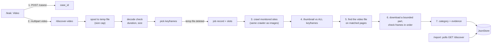

# Video feature: how it works, how it was built, and what it can and cannot do

Upload a video of yourself or another person. Sniffer looks for copies on the monitored websites and returns, for each one: **the site, the page URL, the direct video URL (when one can be found), and a match category with the evidence behind it.**

This document describes what is **built and tested**. It follows the design in `IMAGE_FIXES_AND_VIDEO_ARCHITECTURE.md` (Part 2) and notes where the build differs.

---

## 1. Decision: one service, or a new microservice?

**Decision: keep it in the analysis service, in its own modules, with a clean seam for later extraction.**

| Question | Answer |
|---|---|
| What does video need? | The crawler, the network guard, scan budgets and slots, the job store, the matcher, the result model, and the report's polling route. All of these already live in the analysis service. |
| What would a new service cost? | Either duplicating all of that or adding service-to-service calls (two job stores, two sets of limits, a network hop for every thumbnail). |
| What is the load? | One video scan at a time, two scans overall. That does not need its own server. |
| What is the genuine reason to split? | Decoding untrusted video files, which is the riskiest new operation. |

How that risk is handled now: the upload is size-capped and streamed to disk; the file must actually decode; duration, dimensions and extraction time are capped; the file is deleted as soon as keyframes exist; only one video scan runs at a time.

**The seam:** `engine/video.py`, `engine/matching.py` and `engine/verify.py` do not import FastAPI. They take plain inputs (paths, bytes, an HTTP client) and return plain results. Moving them into a separate worker means writing a thin API in front of them, not rewriting them.

**Split it out when** any of these happens: more than one server is needed, video decoding slows normal requests, or the decoder must be sandboxed in its own container.

---

## 2. What was built

| File | Role |
|---|---|
| `engine/matching.py` (new) | The image matching code, moved out of `discovery.py` so image and video share one matcher, plus the video matcher. Image behaviour is unchanged (calibration numbers identical, all earlier tests pass). |
| `engine/video.py` (new) | Streamed upload to a private temp file, validation by decoding, keyframe selection. |
| `engine/verify.py` (new) | Bounded video download, frame comparison, the chronological-order check, and the category rules. |
| `engine/discovery.py` | The crawler now takes a matcher, so a video scan runs the same crawl. Adds the video-URL extractor and resolver, and runs the verification stage. |
| `routers/analysis.py` | `POST /{case_id}/discover-video`. The image and video endpoints now share the validation, slot and job code. |
| `engine/models.py` | New optional fields. Image results are unchanged. |
| `apps/web/app/leak/page.tsx` | Image / Video toggle, video validation, a preview frame taken in the browser. |
| `apps/web/components/report/ContentTrace.tsx` | Category badge, video URL, matched moment, verification text. |
| `apps/web/components/report/LeakActionConsole.tsx`, `app/takedown/page.tsx` | Video URLs are added to the takedown notices. |

---

## 3. The workflow, step by step



1. **Choose Video** on `/leak`. The browser checks the type and a 100 MB limit, and draws one frame as a preview (kept in `sessionStorage`, as for images).
2. **Case** is created exactly as for images.
3. **Upload** to `POST /api/analysis/{id}/discover-video`. Slots are taken first, so a busy server answers `429` *before* receiving a large file. The upload is streamed to a private temp file and abandoned at the cap (`413`). The type label is not trusted: the file must decode (`422` otherwise), stay under 10 minutes, and have sensible dimensions.
4. **Keyframes** (`extract_keyframes`): up to 40 evenly spaced frames are sampled; black and flat frames are dropped (they hash alike and cause false matches); then up to 16 are kept by choosing the frames most different from each other, so every scene is represented and near-duplicates are dropped. The temp file is deleted at this point. The keyframes live only in memory for the length of the job.
5. **Reference**: each keyframe is prepared like an image reference (hash variants, mirrored, standard crops, SIFT features).
6. **Crawl**: unchanged (sitemaps, feeds, guarded fetches, byte caps, budgets, honest per-site status).
7. **Stage 1, thumbnail match**: each thumbnail is hashed once and ranked against **every** keyframe with the cheap hashes. Only the 3 closest keyframes get the geometric test (SIFT + RANSAC). The result records which keyframe and moment of your video it resembles.
8. **Stage 2, find the video file**: for the top 12 matched pages that look like one video's own page, the page is fetched through the guard and searched for `og:video`, `<video>`/`<source>`, JSON-LD `contentUrl`/`embedUrl`, `.mp4/.webm/.mov/.m3u8/.mpd` links in the page source and iframes. Each is labelled **direct** (a file), **stream** (a playlist, never downloaded as a file) or **embed** (a player page). If nothing is exposed the field is `null`; nothing is guessed. Thumbnails on a listing page (home, `/videos`, `/tag/...`) are skipped, because the page does not say which video belongs to the thumbnail.
9. **Stage 3, verify** (direct files only, at most 6 per scan): download at most 6 MB through the guarded client (`Range` request, abandoned at the cap), decode a frame every 2 s, and match each against your keyframes (exact, near-duplicate or structural only; "probable" is too weak). The matched frames must be in **chronological order** (longest strictly increasing run of your-video time against their-video time). Three ordered frames verify the match, and the run's first and last moments give the time range in your video.
10. **Category and evidence** (`apply_evidence`), saved to the job record.
11. **Report** polls the same `GET /discover`; it shows the category, the video URL, the matched moment and a plain statement of what was and was not checked. Notices include the video URL.

---

## 4. What the user sees

| Category | Meaning | Rule |
|---|---|---|
| **Video verified** | Frames of their actual video match yours in the same order | Stage 3 finds at least 3 ordered, geometrically verified frames |
| **Strong match** | The thumbnail clearly matches, or several of your frames matched | Exact, near-duplicate or structural thumbnail match, or 2 or more keyframes matched |
| **Possible match** | One weaker thumbnail match | Probable-tier match only |

`confidence` is still returned for compatibility. For a verified match it is raised to at least 90 plus 2 per ordered frame (maximum 99).

The verification result is always one of: `verified`, `partial` (frames matched but not enough in order), `no_frame_match` (none matched in the part checked, which does not rule out a match later), `not_verified` (could not be checked; the reason is given), `not_attempted` (no direct video file).

---

## 5. API

`POST /api/analysis/{case_id}/discover-video` (multipart)

| Field | | |
|---|---|---|
| `video` | required | mp4, mov, webm, mkv, m4v. Max 100 MB, max 10 minutes. `application/octet-stream` is accepted only with a video file extension. |
| `origin_domain` | optional | Same validation as images. |
| `evidence_image` | optional | Same as images. |

Responses: `202` queued; `409` a scan is already running for this case; `413` too large; `415` wrong type; `422` cannot be decoded, too long, or bad `origin_domain`; `429` too many scans.

The result is read with the existing `GET /api/analysis/{case_id}/discover`. New fields (the values below are illustrative, not real output):

```json
{
  "input_type": "video",
  "reference_frames": 16,
  "video_info": {"duration_seconds": 15.0, "width": 480, "height": 270, "keyframe_times": [0.0, 1.6, 3.1]},
  "direct_matches": [{
    "domain": "copy.example",
    "page_url": "https://copy.example/watch/1",
    "video_url": "https://copy.example/v/copy.mp4",
    "video_url_type": "direct",
    "category": "verified",
    "confidence": 99.0,
    "matched_frame_time": 7.5,
    "matched_segment": {"start": 3.8, "end": 12.6},
    "evidence": {"verification": "verified", "ordered_frames": 4, "frames_matched": 1,
                 "video_url_found": true, "seconds_checked": 14.0}
  }]
}
```

Only keyframe **times** are stored, never frames or video. Image results are unchanged (`category`, `video_url` and the other video fields are `null`).

---

## 6. Limits and configuration

| Variable | Default | Meaning |
|---|---|---|
| `SNIFFER_MAX_VIDEO_MB` | 100 | Upload size cap |
| `SNIFFER_MAX_VIDEO_SECONDS` | 600 | Duration cap |
| `SNIFFER_MAX_CONCURRENT_VIDEO_SCANS` | 1 | Video scans at once (they also use a general scan slot) |
| `SNIFFER_VERIFY_VIDEO` | 1 | Set to 0 to turn stage 3 off (thumbnail matching and URL discovery stay on) |
| `SNIFFER_VERIFY_MAX_BYTES` | 6 MB | Bytes read from each candidate video |
| `SNIFFER_VERIFY_MAX_CANDIDATES` | 6 | Candidate videos verified per scan |

All the image-scan settings from `IMAGE_FIXES_AND_VIDEO_ARCHITECTURE.md` section 6 (budgets, retention, network guard) apply to video scans too.

---

## 7. Evidence that it works

**Tests: 69 pass** (`cd services/analysis && python -m pytest tests -q`). The video tests generate real MP4 files (five scenes with slow zoom and pan) and serve a fake internet that hosts:

| Site in the test | What it hosts | Required outcome | Result |
|---|---|---|---|
| copy | Your video, first scene cut, shrunk, watermarked, re-encoded | `verified`, time range starting after your first scene | pass (segment 3.8 to 12.6 s) |
| shuffled | Same scenes in reverse order | **not** verified (`partial`) | pass |
| lookalike | A matching thumbnail, but a different video behind it | `no_frame_match`, not verified | pass |
| thumbonly | Matching thumbnail, `.m3u8` stream | URL reported as `stream`, not downloaded | pass |
| noplayer | Matching thumbnail, no player in the HTML | `video_url: null` | pass |
| unrelated | Unrelated thumbnail | not reported | pass |

Also tested: black intro frames dropped; non-video files, corrupt files and empty files rejected; duration and size caps; temp files never left behind (success, 413, 422); slots released after success and after every kind of rejection; a busy video slot gives `429` without leaking the general slot; a truncated download of an MP4 whose index is at the end is reported as `not_verified` (not as a failed match); downloads to internal addresses are blocked; the image scan is unaffected.

**Live server over real sockets:** a real 889 KB MP4 was uploaded to a running server (202 in 0.3 s, 16 keyframes), the scan completed, results matched the table above, survived a server restart, and no temp files remained.

**Measured costs (test machine):**

| Step | Time |
|---|---|
| Keyframe extraction (15 s video) | about 0.33 s |
| Building the reference (16 keyframes) | about 2.1 s, once per scan, in the background |
| One thumbnail against all keyframes | about 100 to 120 ms (image scans: about 57 ms) |
| Verifying one candidate video | about 0.6 to 0.9 s |

At 100 ms per image, the 8,000-image budget is about 800 CPU-seconds, spread over 4 workers: within the 10-minute scan limit, but video scans are noticeably heavier than image scans.

**Front end:** type-check passes. Lint reports exactly the same findings as before my changes (7 existing errors in `app/takedown/page.tsx` and `LeakActionConsole.tsx`; none added). **Not verified:** the pages in a browser, and a production `next build` (this sandbox cannot download Google Fonts, which the build requires).

---

## 8. Known limits

- **Only the monitored sites are searched.** A copy elsewhere will not be found.
- **Verification reads only the first 6 MB** of a candidate video. Your clip must overlap the start of their video to be verified; otherwise the result stays "strong" or "possible", never wrongly "verified" and never "not a copy".
- **MP4 files with the index at the end** cannot be decoded from a partial download. They are reported as `not_verified` with that reason. Files written for streaming (index at the start) work.
- **Streams (`.m3u8`, `.mpd`) and embeds** are reported but not downloaded. DRM-protected video is not handled.
- **Sites that build the player in JavaScript** show `video_url: null`; the source page is still reported.
- **Look-alike backgrounds.** Two different videos filmed in the same room can share background features. Requiring at least 3 geometrically verified frames *in order* makes this unlikely, but not impossible.
- **Frame-to-thumbnail matching** depends on the thumbnail showing a moment you uploaded. A thumbnail from a part of the original video that is not in your clip will not match at stage 1.
- **The thresholds are starting values** (3 ordered frames; the image-matching thresholds from the earlier work). They are tested on synthetic videos built from sample photographs, not on real leaked content. Calibrate on a labelled set before relying on the categories.
- **Decoding untrusted files is a risk.** OpenCV bundles FFmpeg, which has had security fixes over time: keep `opencv-python-headless` up to date, and move decoding into a sandboxed worker (section 9) if the service becomes public-facing.
- **The preview frame** is drawn in the browser; if the browser cannot decode the format, a neutral placeholder is shown instead (the upload still works).
- **Other work in the application is untouched:** access control is still missing (anyone with a case ID can read it), and the takedown service still fetches arbitrary domains. Both matter more now that the data is video; fix them before launch.

---

## 9. Extracting it later

When a trigger from section 1 happens:

1. Expose `engine/video.py`, `engine/matching.py` and `engine/verify.py` behind a small API (upload, status, result) in a new service.
2. Move the job store from `JsonStore` to a database shared by both services.
3. Keep the network guard in front of every outbound request in the new service.
4. Replace the in-process thread with a queue consumer if more than one worker is needed.

The analysis service would then call the new service, or the browser would talk to it directly; the result shape does not change.
